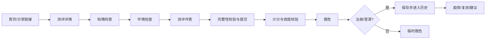

# MindMeter 功能需求规范

| 项目 | 内容 |
| --- | --- |
| 文档编号 | MM-REQ-002 |
| 版本 | v0.2（草案） |
| 状态 | 评审中 |
| 文档负责人 | 【SONG-bot418：产品负责人】 |
| 评审人 | 【SONG-bot418：技术/算法/设计/QA/法务】 |
| 最后更新 | 2026-10-17 |
| 上游文档 | [问题定义与产品描述](problem_definition.md) |
| 关联文档 | [非功能需求规范](nonfunctional_spec.md)、[算法设计](../algorithm.md)、[软件设计](../software.md) |

## 修订记录

| 版本 | 日期 | 作者 | 变更说明 |
| --- | --- | --- | --- |
| v0.1 | 2026-10-17 | 【宋朔航】 | 初稿：角色、功能需求、业务规则、数据模型、接口与验收框架 |
| v0.2 | 2026-10-17 | 【宋朔航】 | 修订：移除运营后台/通知/付费残留，角色精简为 3 类；落实 10 项决策并替换全部【待定】；补充协议同意、账号安全、自动化决策告知、投诉渠道；新增 5 个接口与 3 个数据实体；修复状态机缺口 |

## 1. 引言

### 1.1 目的

本文定义 MindMeter MVP 的功能边界、行为规则与验收标准，供产品、设计、开发、测试与合规共同使用。需求编号稳定，变更须走 §16 的流程。

### 1.2 范围

覆盖：账号与身份、测评执行、计分与报告、历史追踪、分享与隐私、数据权利。

不覆盖：临床诊断、治疗建议、心理咨询撮合、付费与订阅、运营后台、通知推送服务、企业组织架构与席位计费、第三方登录（首版）、原生 App 专属能力。

### 1.3 读者

- 产品/项目：确认范围与优先级；
- 设计/前端：交互、状态与异常；
- 后端/算法：接口、数据与计分契约；
- QA：测试用例与验收；
- 法务/隐私：同意、数据权利与免责边界。

### 1.4 术语

| 术语 | 说明 |
| --- | --- |
| 测评（Assessment） | 一套固定版本的题目、计分规则与报告模板的集合 |
| 测评会话（Session） | 用户一次作答过程，含状态、作答、环境与时间信息 |
| 有效作答（Valid Response） | 通过完整性校验与效度规则、可用于计分的作答 |
| 常模（Norm） | 解释分数用的参照样本分布 |
| 低可信（Low Confidence） | 效度校验发现异常，结果仅作参考 |
| P0/P1/P2 | 必须/应该/可以；P0 未完成不得发布 |

## 2. 产品概述

### 2.1 产品目标

让普通用户在 20 分钟内完成一次可信、可理解的心智测评，并获得可执行的下一步建议；通过复测与趋势，把一次性测评转化为长期自我认知工具。

### 2.2 用户角色

首版只实现 3 类角色，其余角色（内容管理员、客服、分析师、顾问）由项目组开发人员兼任，不单独建账号体系。

| 角色 | 说明 | 关键权限 |
| --- | --- | --- |
| 游客 Visitor | 未登录用户 | 浏览公开内容、完成 1 次基础测评、查看临时报告（24 小时内） |
| 注册用户 User | 已注册并同意协议 | 保存报告、查看历史、管理隐私、申请导出/删除 |
| 管理员 Admin | 项目组开发与运维人员 | 配置题库与量表、查看聚合指标、处理数据请求；访问个体作答需理由与留痕 |

### 2.3 系统边界

| 内部 | 外部依赖 |
| --- | --- |
| Web 前端、Backend API、Core Engine、数据库、静态资源 | 短信/邮件服务（仅验证码与账号通知）、对象存储、错误监控 |

外部服务不得接收作答原文或可识别身份信息；如使用第三方统计，需经安全评审。

### 2.4 前提与约束

- 首版为响应式 Web，移动端优先；
- 首版仅简体中文；
- 首版限制 16 岁及以上；
- 仅使用公开授权或团队自编量表，未获授权的量表不得上线；
- 所有面向用户的结论必须附免责声明与局限说明；
- 首版不接入支付、运营后台与推送服务。

## 3. 核心用户旅程



关键体验要求：

1. 从进入到开始测评不超过 3 次点击（不含同意勾选）；
2. 任一环节失败都可恢复，不丢失已作答内容；
3. 报告首屏必须让用户看懂「这是什么、有多可信、下一步做什么」；
4. 基础结果与隐私设置不得被任何条件阻断。

## 4. 功能需求总览

| 模块 | 编号范围 | 需求数 | 优先级分布 |
| --- | --- | --- | --- |
| 账号与身份 | FR-100–199 | 9 | P0×5，P1×3，P2×1 |
| 测评与任务 | FR-200–299 | 10 | P0×6，P1×2，P2×2 |
| 计分与报告 | FR-300–399 | 11 | P0×8，P1×2，P2×1 |
| 追踪与成长 | FR-400–499 | 6 | P0×1，P1×3，P2×2 |
| 分享与隐私 | FR-500–599 | 4 | P0×2，P1×2 |
| 数据权利 | FR-800–899 | 6 | P0×5，P1×1 |

合计 46 条，其中 P0 27 条。

## 5. 详细功能需求

### 5.1 账号与身份（FR-100）

| ID | 需求 | 优先级 | 验收标准 |
| --- | --- | --- | --- |
| FR-101 | 游客测评 | P0 | 未登录用户每 30 天可完成 1 次基础测评并查看报告；临时结果保留 24 小时；注册后可合并到账号，合并前明确告知范围 |
| FR-102 | 注册与登录 | P0 | 支持手机号+验证码（首选）与邮箱+密码（备选）；验证码 5 分钟有效、错误次数受限；登录态默认 30 天；支持退出全部设备 |
| FR-103 | 第三方登录 | P2 | 本期不实现；后续接入微信/Apple 时需绑定手机号，并提供解绑与账号合并路径 |
| FR-104 | 年龄与身份声明 | P0 | 注册时声明出生年份；未满 16 岁阻止注册并提示；年龄信息仅用于合规与常模分层，不公开展示 |
| FR-105 | 账号注销与删除 | P0 | 应用内可发起；二次确认并说明后果；15 个工作日内完成删除或匿名化；备份副本 30 天内轮转清除，须在文案中明确告知；结果以站内信告知 |
| FR-106 | 多端同步 | P1 | 同一账号在不同设备看到一致的报告与历史；冲突以服务端版本为准；同一会话同一时间只允许一个活跃作答端，后进入的设备提示接管或退出 |
| FR-107 | 授权管理 | P1 | 用户可查看并撤回研究、产品改进授权；撤回后停止后续处理，不影响此前已完成的合法处理 |
| FR-108 | 协议同意 | P0 | 注册时必须主动勾选《用户协议》与《隐私政策》（默认不勾选）；记录协议版本、时间与用户标识；协议更新后重大变更需重新同意 |
| FR-109 | 账号安全 | P1 | 支持找回密码、修改密码、换绑手机号/邮箱；敏感操作需二次验证；连续失败触发限流 |

**FR-102 补充规则**：

- 密码长度 ≥ 10，禁止常见弱密码；服务端使用 Argon2id/bcrypt 存储；
- 验证码发送频控：同一手机号 60 秒 1 次、每日 ≤ 10 次；防撞库与枚举；
- 登录、改密、注销等敏感操作需二次验证。

### 5.2 测评与任务（FR-200）

| ID | 需求 | 优先级 | 验收标准 |
| --- | --- | --- | --- |
| FR-201 | 测评目录与详情 | P0 | 展示名称、目的、维度、预计时长、题目数量、适用人群、局限与免责声明；未登录可查看 |
| FR-202 | 知情同意 | P0 | 用可读语言说明数据用途、保存期限、自愿参与、退出方式、风险与联系方式；心理测评数据属敏感个人信息，须单独同意（独立勾选项）；必须主动勾选方可开始；记录同意版本、时间与用户标识 |
| FR-203 | 测评前环境检查 | P0 | 检查浏览器/设备、网络、屏幕、输入方式；不通过时给出可操作建议；允许在知情风险下跳过并记录 |
| FR-204 | 测评运行 | P0 | 单题单屏、进度可见；按题型计时/限时；每次作答即时保存；输入延迟目标 ≤100ms；异常退出不丢已答 |
| FR-205 | 中断与恢复 | P0 | 刷新/断网/切换设备后可在 24 小时内恢复；恢复后定位到上次题目；超时自动提交或标记放弃，规则明确 |
| FR-206 | 提交与完整性校验 | P0 | 提交前检查必答题、异常快答、重复提交；用户确认后提交；提交幂等，重复请求不产生第二份结果；展示提交成功回执 |
| FR-207 | 防作弊与异常检测 | P1 | 记录切屏、复制粘贴、多开、异常速度等信号；达到阈值标记低可信而非直接封禁；提供申诉入口，5 个工作日内答复；规则不公开细节以防规避 |
| FR-208 | 自适应调度（CAT） | P2 | v1.1 启用，首版不实现；启用时按能力估计选题，控制题目曝光与内容平衡；同一版本可复现；无合适题库时回退固定题本 |
| FR-209 | 无障碍作答 | P1 | 键盘可完成；屏幕阅读器可读题与选项；允许延长时限/暂停（需记录，可能影响常模解释）；提供减少动效 |
| FR-210 | 多语言 | P2 | 架构支持 i18n；首版仅 zh-CN；翻译不影响计分版本 |

**FR-204 计时规则**：

- 认知任务类：按任务范式固定刺激时长与反应窗口，超时记为缺失/错误；
- 自评量表类：不强制单题限时，但记录总时长用于效度参考；
- 用户主动暂停仅限允许的题型，暂停次数与时长记录并在报告中提示。

### 5.3 计分与报告（FR-300）

| ID | 需求 | 优先级 | 验收标准 |
| --- | --- | --- | --- |
| FR-301 | 自动计分 | P0 | 提交后自动触发；结果 ≤10 秒返回；同输入同版本结果一致；计分版本随会话固定，不受后续配置变更影响 |
| FR-302 | 效度校验 | P0 | 至少覆盖作答一致性、反应时异常、缺失/随机作答；输出可信等级与原因；低可信时不展示确定性结论 |
| FR-303 | 常模与百分位 | P0 | 按适用分层计算百分位与置信区间；无可用常模时展示原始分并明确说明；常模版本可追溯 |
| FR-304 | 多维画像 | P0 | 每个维度展示分数/百分位、描述性区间与一句话解释；不使用「好/坏/正常/异常」等诊断化标签；移动端可读 |
| FR-305 | 报告生成 | P0 | 报告包含：摘要、维度、可信度、解释、建议、局限、免责声明、求助资源；5 名目标用户测试中至少 4 人可在 10 秒内说出核心结论；支持同版本重新生成 |
| FR-306 | 解释与行动建议 | P0 | 建议 3–5 条，具体、可执行、可验证；与维度结果对应；不提供药物、治疗或诊断建议；标注不确定性 |
| FR-307 | 安全提示与危机资源 | P0 | 涉及自伤/自杀相关题目或关键词时，展示求助热线与紧急资源；说明产品不能提供危机干预；不因此自动标记用户为高风险或对外共享 |
| FR-308 | 报告版本与重算 | P1 | 旧报告不可原地篡改；重算生成新版本并标注差异；用户可查看历史版本 |
| FR-309 | 报告导出 | P1 | 支持通过浏览器打印生成 PDF；导出需登录与二次确认；文件包含报告编号与生成时间 |
| FR-310 | AI 辅助解读 | P2 | 本期不实现；如启用须明确标注 AI 生成、可关闭、不替代专业意见，输入脱敏并经安全过滤 |
| FR-311 | 自动化决策告知 | P0 | 报告结论与建议由规则/模型自动生成，须在报告页说明生成方式、依据维度与局限；用户可申请人工复核，5 个工作日内答复 |

**FR-302 低可信展示规则**：

- 低可信时只展示原始分、作答完整度与提示语，不展示百分位、等级标签与确定性建议；
- 提示用户谨慎参考，并给出重测建议；
- 该规则同样适用于分享卡片与导出文件。

**FR-305 报告结构（建议顺序）**：

1. 一句话结论 + 可信度徽标；
2. 多维画像图与维度卡片；
3. 结果解释（含「这意味着什么/不意味着什么」）；
4. 3–5 条行动建议；
5. 局限与下次复测建议；
6. 免责声明、生成方式说明与求助资源；
7. 分享/导出/删除入口。

**FR-307 安全规则**：

- 危机资源文案需经项目组与指导老师审核；
- 热线号码与地区必须可配置、可更新；
- 不做风险分级推送，不将危机信号用于营销；
- 相关事件单独记录，限制访问。

### 5.4 追踪与成长（FR-400）

| ID | 需求 | 优先级 | 验收标准 |
| --- | --- | --- | --- |
| FR-401 | 历史记录 | P0 | 按时间倒序列出测评；展示日期、版本、可信度、主要维度；支持分页与单条删除；删除后不可恢复 |
| FR-402 | 趋势对比 | P1 | 选择 2 次及以上测评生成趋势；仅比较同维度、可比的版本；展示变化方向与置信区间；明确「变化不等于因果」 |
| FR-403 | 复测提示 | P1 | 默认关闭，用户主动开启；建议间隔 ≥14 天；以登录后站内提示呈现，不发送短信/邮件 |
| FR-404 | 个性化建议/训练计划 | P1 | 基于结果生成 2–4 周计划；任务可完成、可跳过、可调整；不承诺疗效；完成情况可追踪 |
| FR-405 | 目标与打卡 | P2 | 用户可设定小目标并记录；数据仅本人可见；可一键关闭 |
| FR-406 | 阶段总结 | P2 | 每 4 次测评生成一次总结；可分享（脱敏）；可关闭 |

### 5.5 分享与隐私（FR-500）

| ID | 需求 | 优先级 | 验收标准 |
| --- | --- | --- | --- |
| FR-501 | 分享卡片 | P1 | 用户选择展示维度；默认隐藏分数、年龄、姓名与敏感维度；卡片含产品标识与「非诊断」提示；可预览后分享 |
| FR-502 | 可见性控制 | P0 | 报告默认仅本人可见；分享链接可设置有效期/随时取消，过期或撤销后访问返回统一提示；通过匿名 token 访问，不暴露用户身份；不提供公开个人主页；搜索引擎不可索引个人报告 |
| FR-503 | 匿名/昵称 | P1 | 用户可使用昵称，不强制真实姓名；昵称不用于常模或对外展示（除非用户主动分享） |
| FR-504 | 数据使用授权 | P0 | 研究/产品改进授权与主服务分开、默认关闭；拒绝不影响基础功能；授权可撤回；文案不得使用诱导性设计 |

### 5.6 数据权利（FR-800）

| ID | 需求 | 优先级 | 验收标准 |
| --- | --- | --- | --- |
| FR-801 | 数据导出 | P1 | 用户可申请导出账号、同意、测评与报告数据；身份验证后 15 个工作日内提供；格式为 JSON |
| FR-802 | 同意记录 | P0 | 记录同意类型、版本、时间、方式与撤回；可导出；主服务与可选授权分开 |
| FR-803 | 删除与保留 | P0 | 按数据分类执行保留期；注销后删除/匿名化；备份中的副本 30 天内轮转清除；删除完成后站内信告知 |
| FR-804 | 访问审计 | P0 | 管理员访问个体作答需填写理由并留痕；每季度复核异常访问 |
| FR-805 | 政策更新 | P0 | 隐私政策/用户协议重大变更需重新同意；版本可追溯；旧版本保留 |
| FR-806 | 处理者信息与投诉 | P0 | 隐私政策中列明个人信息处理者名称、联系方式、投诉渠道与响应时限；用户可在应用内提交投诉并查看处理状态 |

## 6. 业务规则

| ID | 规则 | 说明 | 优先级 |
| --- | --- | --- | --- |
| BR-001 | 非诊断 | 所有结果与文案不得构成临床诊断、治疗建议或风险判定 | P0 |
| BR-002 | 复测间隔 | 同量表建议间隔 ≥14 天；过近复测提示练习效应，不默认禁止 | P1 |
| BR-003 | 年龄门槛 | 首版仅 16+；未满 16 岁不得注册与测评 | P0 |
| BR-004 | 版本不可变 | 已发布的量表、计分、常模版本不可原地修改；变更新建版本；下架量表时已开始的会话按原版本完成 | P0 |
| BR-005 | 低可信处理 | 效度异常时展示可信度警示与重测建议，隐藏或弱化确定性结论 | P0 |
| BR-006 | 数据保留 | 作答与报告保留账号存续期 + 3 年；审计日志 180 天；备份 30 天轮转 | P0 |
| BR-007 | 免费额度 | 游客每 30 天可完成 1 次基础测评；注册用户不限次数 | P1 |
| BR-008 | 默认私密 | 报告、分享、研究授权均默认关闭/仅本人可见 | P0 |
| BR-009 | 研究使用 | 仅在单独、明确、可撤回的授权下用于研究；输出为聚合结果 | P0 |
| BR-010 | 自动化决策 | 报告结论与建议由规则/模型自动生成；须说明生成方式并允许用户申请人工复核 | P0 |
| BR-011 | 紧急情况 | 危机信号仅用于展示资源，不用于风控、营销或对外共享 | P0 |
| BR-012 | 未成年人 | 若未来开放 16 岁以下，需监护人同意与单独评估 | P2 |

## 7. 数据模型（概念级）

| 实体 | 关键字段 | 说明 |
| --- | --- | --- |
| User | id、手机号/邮箱（加密/哈希）、昵称、出生年份、状态、创建时间 | 最小化采集；敏感字段加密 |
| Consent | id、user_id、类型、版本、时间、方式、撤回时间 | 不可篡改，支持导出 |
| Assessment | id、名称、版本、维度、题目数、预计时长、状态 | 版本化；发布后只读 |
| Item | id、assessment_id、题型、题干、选项、计分键、参数、顺序 | 题目参数与内容分离管理 |
| Session | id、user_id/匿名 id、assessment_id、版本、状态、开始/提交时间、设备信息、可信等级 | 设备信息脱敏 |
| Response | id、session_id、item_id、答案、反应时、是否缺失 | 原始作答，访问受限 |
| Score | id、session_id、维度、原始分、标准分、百分位、置信区间、计分版本 | 可重算，保留历史 |
| Norm | id、维度、分层、样本量、版本、来源 | 公开说明局限 |
| Report | id、session_id、模板版本、内容快照、生成时间、可见性 | 不可原地修改 |
| Recommendation | id、report_id、类型、内容、完成状态 | 不承诺疗效 |
| ShareLink | id、report_id、token、过期时间、撤销时间 | 匿名访问，可随时撤销 |
| SessionToken | id、owner_type（user/guest）、owner_id、token、过期时间、设备标识 | 支持游客匿名会话与"仅本人可见" |
| IdempotencyKey | key、endpoint、请求摘要、结果、过期时间 | 保证提交/导出幂等 |
| AuditLog | id、actor、动作、对象、时间、结果、理由 | 保留 180 天以上 |

**数据分级**：

| 级别 | 示例 | 要求 |
| --- | --- | --- |
| L1 公开 | 测评介绍、科普内容 | 可公开 |
| L2 内部 | 聚合指标、配置 | 授权访问 |
| L3 敏感 | 账号标识、同意记录 | 加密、最小权限、审计 |
| L4 高敏感 | 作答原文、报告、危机相关记录 | 强加密、严格授权、禁止导出到个人设备 |

## 8. 接口需求

### 8.1 通用约定

- 风格：REST + JSON，路径版本 `/api/v1`；
- 认证：Bearer JWT（短期 access + 可轮换 refresh）；匿名会话使用受限 token；
- 时间：ISO 8601 UTC；数据库存 UTC，展示按 Asia/Shanghai；
- 幂等：提交、导出、删除等使用 `Idempotency-Key`；
- 错误：统一 `code/message/trace_id`，不泄露内部堆栈；
- 分页：cursor 优先；默认 20，最大 100；
- 限流：按用户/IP/接口分级，返回 `429` 与重试提示；
- 审计：敏感接口记录 actor、对象、结果与理由。

### 8.2 接口清单（MVP）

| 方法 | 路径 | 说明 | 认证 |
| --- | --- | --- | --- |
| POST | `/auth/otp` | 发送验证码 | 否 |
| POST | `/auth/login` | 登录/注册 | 否 |
| POST | `/auth/refresh` | 刷新令牌 | Refresh |
| POST | `/auth/logout` | 退出（可全员退出） | 用户 |
| POST | `/auth/password/reset` | 找回密码 | 否 |
| PATCH | `/auth/password` | 修改密码/换绑 | 用户 |
| GET | `/assessments` | 测评列表 | 否 |
| GET | `/assessments/{id}` | 测评详情 | 否 |
| POST | `/sessions` | 创建会话 | 可选 |
| POST | `/sessions/{id}/consent` | 记录知情同意 | 会话 |
| PATCH | `/sessions/{id}` | 保存作答/进度 | 会话 |
| POST | `/sessions/{id}/abandon` | 放弃会话 | 会话 |
| POST | `/sessions/{id}/submit` | 提交并触发计分 | 会话 |
| GET | `/sessions/{id}/status` | 查询状态 | 会话 |
| GET | `/reports/{id}` | 获取报告 | 本人 |
| POST | `/reports/{id}/regenerate` | 重新生成报告 | 本人 |
| GET | `/reports/{id}/versions` | 报告历史版本 | 本人 |
| POST | `/reports/{id}/share` | 创建分享链接 | 本人 |
| DELETE | `/reports/{id}/share` | 取消分享 | 本人 |
| GET | `/share/{token}` | 匿名访问分享报告 | 否 |
| GET | `/me/assessments` | 历史列表 | 用户 |
| DELETE | `/me/assessments/{id}` | 删除单条历史 | 用户 |
| GET | `/me/trends` | 趋势数据 | 用户 |
| GET | `/me/reminders` | 复测提示 | 用户 |
| GET | `/me/consents` | 同意记录 | 用户 |
| POST | `/me/export` | 申请导出 | 用户 |
| DELETE | `/me` | 注销 | 用户 + 二次验证 |

接口字段、错误码与 OpenAPI 文档在 M1 完成后补充到 `docs/api/`【待建】。

## 9. 权限矩阵

| 能力 | 游客 | 注册用户 | 管理员 |
| --- | --- | --- | --- |
| 浏览公开内容 | ✅ | ✅ | ✅ |
| 完成基础测评 | ✅（1 次/30 天） | ✅ | — |
| 查看本人报告 | 临时（24h） | ✅ | — |
| 查看他人作答 | — | — | 审批后并留痕 |
| 配置题库与量表 | — | — | ✅ |
| 查看聚合指标 | — | — | ✅ |
| 导出个体数据 | — | 本人 | 审批后 |
| 删除用户数据 | — | 本人 | ✅ |
| 查看审计日志 | — | — | ✅ |

## 10. 测评会话状态机

| 状态 | 说明 | 允许的下一状态 |
| --- | --- | --- |
| `CREATED` | 已创建，未同意 | `CONSENTED`、`EXPIRED` |
| `CONSENTED` | 已同意，未开始 | `IN_PROGRESS`、`ABANDONED`、`EXPIRED` |
| `IN_PROGRESS` | 作答中 | `PAUSED`、`SUBMITTED`、`ABANDONED`、`EXPIRED` |
| `PAUSED` | 用户主动暂停（仅允许的题型） | `IN_PROGRESS`、`ABANDONED`、`EXPIRED` |
| `SUBMITTED` | 已提交，待计分 | `SCORING`、`FAILED` |
| `SCORING` | 计分中 | `SCORED`、`FAILED` |
| `SCORED` | 计分完成 | `REPORTED` |
| `REPORTED` | 报告可用 | 终态（可重算生成新版本） |
| `INVALID` | 效度过低/数据异常，由计分服务触发 | 终态；可引导重测 |
| `ABANDONED` | 用户放弃 | 终态 |
| `EXPIRED` | 超过 24 小时未完成 | 终态 |
| `FAILED` | 计分失败 | 重试回 `SCORING`（最多 3 次），超限转 `INVALID` 并保留作答 |

规则：

- 状态迁移必须原子化并记录时间、触发者与版本；
- 提交幂等：同一会话重复提交返回同一 `report_id`；
- 计分失败不得丢失作答；重试使用相同计分版本；
- 同一会话同一时间只允许一个活跃客户端，切换设备需显式接管；
- 任何终态都可被用户删除，但审计日志按规则保留。

## 11. 非功能需求引用

性能、可靠性、安全、隐私、无障碍、兼容性等要求见[非功能需求规范](nonfunctional_spec.md)。功能验收时必须同时满足相关 NFR；冲突时以更严格者为准，并由技术负责人裁决。

## 12. 验收与发布标准

### 12.1 功能验收

- P0 需求全部实现并通过验收用例；
- P1 未完成项有明确排期且不影响核心旅程；
- 关键路径（首次测评、断点续答、报告、注销）端到端通过；
- 异常路径（断网、超时、重复提交、权限不足、量表下架）有明确提示且可恢复。

### 12.2 发布门禁

| 门禁 | 标准 | 证据 |
| --- | --- | --- |
| 功能 | P0 全通过，无 S1/S2 缺陷 | 测试报告 |
| 性能 | 达到 NFR-PERF 门槛 | 压测报告 |
| 安全 | 无高危漏洞，依赖扫描通过 | 安全报告 |
| 隐私 | 同意、导出、删除、保留期可演示 | 合规检查表 |
| 无障碍 | 关键路径 WCAG 2.1 AA | axe + 人工检查 |
| 科学性 | 量表来源、计分与文案经指导老师审核 | 评审记录 |
| 文档 | 运行手册、回滚方案、测试用例齐备 | 发布清单 |

### 12.3 需求验收格式

每条需求至少有一个用例，采用 Given/When/Then 描述；示例（FR-205）：

```gherkin
Given 用户正在进行测评且已作答 10 题
When 用户刷新页面或断网后重新进入
Then 系统恢复到第 10 题并保留此前作答
And 恢复时间不超过 2 秒
And 若超过 24 小时，提示会话已过期并说明是否可重测
```

## 13. 范围外（本期不做）

- 临床诊断、治疗建议、药物/处方相关内容；
- 心理咨询师撮合、预约与支付分账；
- 付费与订阅、运营后台、短信/邮件推送服务；
- 第三方登录（首版仅手机号/邮箱）；
- CAT 自适应调度（v1.1）；
- AI 辅助解读与对话式陪伴；
- 社区、排行榜、用户生成内容；
- 原生 iOS/Android App；
- 多语言（仅保留架构能力）；
- 可穿戴设备数据接入；
- 企业组织架构、席位管理与 SSO。

## 14. 待决策事项

v0.2 已将本表全部决策写入正文，编号保留供追溯。

| ID | 问题 | 结论 | 决策人 | 截止 | 状态 |
| --- | --- | --- | --- | --- | --- |
| D-FR-01 | 游客临时结果保留多久 | 24 小时 | 项目组评审 | 2026.12.1 | 已定 |
| D-FR-02 | 登录方式优先级 | 手机号+验证码优先，邮箱+密码备选 | 项目组评审 | 2026.12.1 | 已定 |
| D-FR-03 | 复测最短间隔 | 14 天 | 项目组评审 | 2026.12.1 | 已定 |
| D-FR-04 | 免费额度与付费墙 | 游客 1 次/30 天；注册用户不限；首版无付费 | 项目组评审 | 2026.12.1 | 已定 |
| D-FR-05 | 报告导出格式 | PDF（浏览器打印生成） | 项目组评审 | 2026.12.1 | 已定 |
| D-FR-06 | 危机资源的触发与展示 | 关键词 + 自评题；仅展示资源，不做风险分级 | 项目组评审 | 2026.12.1 | 已定 |
| D-FR-07 | 是否首版启用 CAT | 不启用，v1.1 再做 | 项目组评审 | 2026.12.1 | 已定 |
| D-FR-08 | 数据保留期 | 账号存续 + 3 年；备份 30 天轮转 | 项目组评审 | 2026.12.1 | 已定 |
| D-FR-09 | 后台双人复核范围 | 不适用（首版无运营后台） | 项目组评审 | 2026.12.1 | 已定 |
| D-FR-10 | 是否接入第三方登录 | 首版不接 | 项目组评审 | 2026.12.1 | 已定 |

## 15. 需求追踪矩阵

| 产品目标（MM-REQ-001） | 对应功能需求 |
| --- | --- |
| 可信测量 | FR-202、FR-204、FR-206、FR-207、FR-301、FR-302、FR-303 |
| 可解释报告 | FR-304、FR-305、FR-306、FR-307、FR-308、FR-311 |
| 可追踪 | FR-401、FR-402、FR-403、FR-406 |
| 低门槛体验 | FR-101、FR-201、FR-203、FR-205、FR-209 |
| 隐私优先 | FR-104、FR-105、FR-107、FR-108、FR-502、FR-504、FR-801、FR-802、FR-803、FR-804、FR-806 |
| 可持续运营 | FR-102、FR-309、FR-404、BR-007 |
| 安全与伦理 | FR-307、BR-001、BR-003、BR-008、BR-009、BR-010、BR-011、BR-012 |

## 16. 变更管理

1. 需求变更提 Issue，说明原因、影响范围（功能/数据/接口/测试/合规）与优先级；
2. 产品负责人评估价值，技术负责人评估成本，必要时由项目负责人升级；
3. P0 范围变更需里程碑评审批准；已批准需求的删除/降级必须记录理由；
4. 变更后更新编号、版本、修订记录与追踪矩阵，通知 QA 与相关方；
5. 紧急缺陷修复可先处理后补文档，但须在 2 个工作日内补齐。

## 17. 附录：需求编写检查清单

- [ ] 有唯一编号、优先级、验收标准
- [ ] 明确正常路径与至少 2 个异常路径
- [ ] 不包含临床化或绝对化表述
- [ ] 涉及个人数据的功能已标注同意、保留期与访问权限
- [ ] 涉及计分/常模的变更已标注版本与审核人
- [ ] 与 NFR、数据模型、接口、追踪矩阵一致
