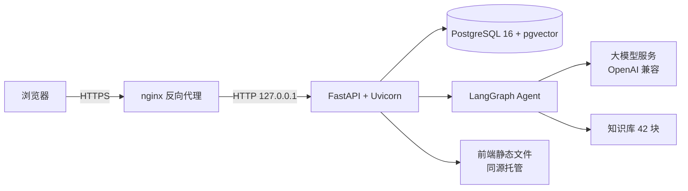
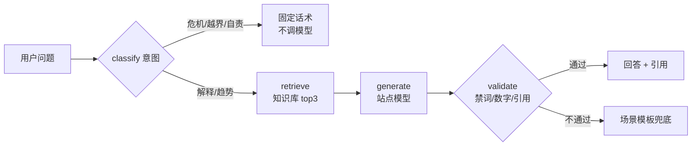
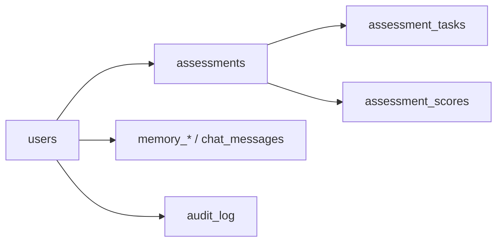

<!-- ============ 封面 ============ -->

  
创新工程实践营 · 项目汇报

  <h1>MindMeter 心智镜</h1>
  
玩一局，看清你的大脑；聊一次，知道下一步。

  
waibibabo666 ｜ xlr268 ｜ song ｜ 1213lz

  
2026 年 11 月

<!-- [0:20] 一句话定位：8 项能力自测 + 对话式 Agent；不设总分、无常模、非诊断。 -->

---
layout: center
---

# 汇报结构

| 部分 | 时长 | 内容 |
| --- | --- | --- |
| 第一部分 | 8 分钟 | 产品设计 · 产品实现 · 软件质量 |
| 第二部分 | 2 分钟 | 本机运行，演示完整功能 |
| 第三部分 | 5 分钟 | 评委提问 |

仓库：github.com/waibibabo666/MindMeter ｜ 文档：docs/ ｜ 版本 v0.3.6

<!-- [0:20] 说明节奏；本页对应参考文档的“第一部分 / 第二部分 / 第三部分”。 -->

---
layout: default
---

## 1.1.1 使命

让认知自测可解释、可回看、**不制造诊断权威**的日常工具。

## 1.1.2 口号

> 玩一局，看清你的大脑；聊一次，知道下一步。

## 1.1.3 目标用户

18 岁以上、关注自身认知状态的学生与职场人；备考、长期用脑、想建立自我基线的人。

<!-- [0:40] 使命里的“不制造诊断权威”是后面所有设计的出发点。 -->

---
layout: default
---

## 1.1.4 如何获得用户

内容种草 + 校园演示：**小红书**（图文体验 / 科普，每周 2–3 篇）→ **B 站**（演示视频 / 开发日志，双周）→ **抖音**（15–60 秒切片）→ 课程与社团演示拿种子用户。**不做付费投放、不做裂变拉新**，用「注册 → 完测 → 7 日复测」漏斗验证内容方向。

## 1.1.5 团队优势

4 人分工：项目负责人、产品与文案、后端与计分、前端与部署；**AI 协作 + 人工评审**。

<!-- [0:30] 获客讲真实渠道，不画大饼；团队优势落在分工与评审机制上。 -->

---
layout: default
---

## 1.1.6 如何做到差异化

| 对比对象 | 它们做什么 | 局限 | MindMeter |
| --- | --- | --- | --- |
| 临床量表（MoCA / MMSE） | 筛查、分界值、教育校正 | 面向临床、需专业人员施测 | 借鉴认知域框架，不采用其计分与分界值 |
| 娱乐型心理测评 | 趣味结果页、强分享 | 无依据、无复测 | 有计分规则、原始指标、可复测 |
| 通用 AI 聊天 | 自由对话 | 不可追溯、容易编数字 | 事实注入 + 数字白名单 + 引用 |
| 同类数字自测 | 红黄绿信号、引导就医 | 借临床权威、制造焦虑 | 自我基线比较，不做信号灯 |

依据：Nasreddine et al., 2005；AERA/APA/NCME, 2014；ADR-0002

<!-- [0:50] 重点讲第 1 行与第 4 行：既不做临床漏斗，也不做娱乐测评。 -->

---
layout: default
---

# 1.2 产品定义

> 对于 **18 岁以上、关注自身认知状态的普通人**，
> 他们 **想了解自己的表现，又不想被贴标签**，
> MindMeter **是一个 Web 认知自测与解读产品**，
> 它能够 **用 8 个维度、三档时长完成自测，并由对话式 Agent 解释结果、给建议、看趋势**，
> 不同于 **临床量表和娱乐测评**，
> 我们的产品 **不设总分、没有常模、不做百分位，只与自己的历史比较**。

<!-- [0:40] 按参考文档的模板逐句宣讲，最后一句是红线。 -->

---
layout: default
---

# 1.2.1 解决的问题

| 问题 | 现状 | 我们的做法 |
| --- | --- | --- |
| 测完看不懂 | 只有一个分数，不知道意味着什么 | 报告 + 术语解释 + 怎么读这组数字 |
| 看完记不住 | 每次从零开始，建议反复 | 记忆：画像 / 摘要 / 建议记录 |
| 单次结论不可比 | 没有常模，却被拿去和别人比 | 自我基线：只与自己的复测比较 |

<!-- [0:40] 三个问题对应三个功能，不是堆功能。 -->

---
layout: default
---

# 1.2.2 对客户的价值（用户故事）

| 用户 | 完成了（活动） | 带来（价值） |
| --- | --- | --- |
| 备考中的学生 | 用 12 分钟完成一次标准测评，看哪一维最低 | 知道练习该从哪里开始，而不是盲目刷题 |
| 刚工作的上班族 | 每月复测一次，回看共同维度的变化 | 判断波动是否稳定、是否与作息有关 |
| 第一次来的访客 | 看完报告后追问“为什么这项低” | 看懂这份报告在说什么，再决定要不要继续 |

<!-- [0:40] 按“用户 / 活动 / 价值”三要素，不使用技术语言。 -->

---
layout: default
---

# 1.2.3 解决方案：Web 应用

  
注册 / 登录

  
→

  
选档位 6 / 12 / 18 分钟

  
→

  
八维测评 限时任务

  
→

  
八维报告 无总分

  
→

  
对话解释 引用 + 护栏

  
→

  
记忆 / 复测 自我基线

- **同源托管**：FastAPI 同时提供 API 与前端静态文件，浏览器不直连模型
- **可离线**：未配置模型时用确定性模板解释，功能不空白

<!-- [0:40] 强调形态是 Web 应用，以及为什么不用小程序：同源托管、部署简单。 -->

---
layout: default
---

# 2 产品设计应用的原则

参考文档列出 12 条原则，这里挑与本品最相关的 6 条说明落地：

| 原则 | 在本产品中的落地 |
| --- | --- |
| 需求原则 | 先回答“分数能说明什么、不能说明什么”，再谈提升 |
| 信息原则 | 八维雷达 + 原始指标 + 来源，不加总分与排名噪音 |
| 创新原则 | 把一次性报告变成可追问、可回看的对话 |
| 系统原则 | 测评 → 计分 → 报告 → 对话 → 记忆 → 复测形成闭环 |
| 收敛原则 | 一个场景一条生成策略，不各写一套 |
| 简化原则 | 不做总分、百分位、账号等级、社交分享 |

<!-- [0:40] 每条原则都要落到具体设计，不能只念条文。 -->

---
layout: default
---

# 3.1 用户体验设计考虑的因素

| 因素 | 设计 |
| --- | --- |
| 设备 | 桌面与手机同一套页面；360px 宽度无横向滚动 |
| 等待 | 三阶段提示（检索 → 生成 → 兜底），不是只转圈 |
| 失败 | 用用户能懂的话说明降级原因，不暴露内部错误码 |
| 可访问性 | 跳转链接、`aria-live`、键盘可达、对比度达标 |
| 隐私与边界 | 对话页常驻敏感信息提醒；报告页常驻非诊断声明 |

<!-- [0:40] 等待、失败、边界提示都是体验的一部分。 -->

---
layout: default
---

# 3.2 编程语言、框架与平台

| 条目 | 内容 |
| --- | --- |
| 程序设计语言 | Python 3.13 / JavaScript ES2022 |
| Web 框架 | FastAPI 0.162.7 + Uvicorn 0.54.0 |
| Agent 编排 | LangGraph 1.2.21 + langchain-core 1.8.0 |
| 数据层 | PostgreSQL 16 + pgvector 0.8.x；SQLAlchemy 2.1.8 / Alembic 1.20.1 |
| 前端 | 无框架，原生 ES Module（无构建） |
| 测试与质量 | pytest 9.2.0、Playwright 1.65、ESLint 10、Prettier 3.9 |

完整依赖见 requirements.txt / package.json；已同步到 README 的“技术栈与版本”一节。

<!-- [0:40] 版本号以仓库锁定文件为准；选型理由下一页展开。 -->

---
layout: default
---

# 3.3 代码仓库链接及提交历史

- 仓库：**github.com/waibibabo666/MindMeter**
- 分支：`develop` 集成 → PR 评审 → `main` 发布
- 每次 PR 自动跑 CI：lint/format、浏览器 E2E、后端契约测试、文档结构、密钥扫描

| 成员 | 提交次数 | 主要职责 |
| --- | --- | --- |
| waibibabo666 | 114 | 项目负责人 |
| 1213lz | 38 | 计分 / RAG / 测试 |
| xlr268 | 30 | 产品与文案 |
| SONG-bot418 | 18 | 前端与部署 |

  
截图占位 · 3.3 提交历史

  
请拍：GitHub → Insights → Pulse（或 Contributors），显示每位成员提交次数

  
建议文件名：docs/slides/images/pulse.png

<!-- [0:40] 提交数据取自 GitHub Contributors；截图由作者补充。 -->

---
layout: default
---

## 3.3（续）团队协作工具

参考文档建议补充 team planning、Kanban、Bug tracker 的项目截图（可选，没有可删掉本页）。

  
截图占位 · 3.3 协作工具（可选）

  
请拍：GitHub Projects / Issues 看板，或团队使用的看板与缺陷跟踪页面

  
建议文件名：docs/slides/images/kanban.png

<!-- [0:20] 没有看板截图就跳过本页，答辩时不失分。 -->

---
layout: default
---

# 3.4 生命周期：主要问题与解决

| 类别 | 问题 | 原因 | 解决办法 |
| --- | --- | --- | --- |
| 架构 | 桌面版 localStorage + 浏览器直连模型不可持续 | 数据不可迁移、Key 有风险 | 迁为 FastAPI + PostgreSQL + 服务端会话 |
| Agent | 报告解读卡绕过校验 | 两条 AI 出口、两套 prompt | 统一出口，走同一张图与同一套校验 |
| 质量 | 校验一刀切误杀好回答 | 缺引用/派生数字就整段回退 | 场景策略 + 软校验 + 派生数字白名单 |
| 部署 | 服务器更新后仍是旧界面 | 前端打进镜像，只 pull 不重建 | 文档写清 pull → rebuild → 重启 |

完整记录见仓库 docs/ 与 CHANGELOG；可直接转存为 wiki。

<!-- [0:50] 四条都对应 commit 与 ADR，答辩可展开任意一条。 -->

---
layout: default
---

# 3.5.1 系统架构图

- 基础设施：一台云服务器 + Docker 单容器；数据库同机或平台托管
- 安全：Cookie 会话（HttpOnly、SameSite=Lax）、同源 JSON 校验、限流、日志脱敏

<!-- [0:50] 架构图按“浏览器 → 反代 → 应用 → 数据/模型/知识”讲，从外到内。 -->

---
layout: default
---

## 3.5.2 基础设施图

只有一台云服务器：Docker 单容器 + 同机或平台 PostgreSQL，nginx 负责 TLS 与反向代理（参考文档说明“只有一台服务器，可不画”）。

## 3.5.3 智能体设计（上）

- 任务编排：LangGraph 显式状态机，场景策略表（对话 / 趋势 / 报告）
- 知识：42 块已审核语料，检索命中不足时明说“不猜”
- 记忆：画像（需确认）、测评摘要、建议记录、最近 20 条对话

<!-- [1:00] 五要素先讲编排、知识、记忆；护栏与降级下一页。 -->

---
layout: default
---

## 3.5.3（续）护栏与降级

| 层 | 规则 |
| --- | --- |
| 意图 | 危机、越界、自责、无关：不调模型，走固定话术（含 12356 求助通道） |
| 场景 | 对话 200 字 / 趋势 300 字 / 报告 150 字；趋势禁用“进步 / 退步”判断 |
| 数字 | 只允许 facts 里的数字及确定性派生（百分比、差值、秒数） |
| 兜底 | 任一硬校验失败 → 场景模板；软校验只记录、不判死 |

AI 出错时，错的只能是措辞。

<!-- [0:50] 这一页是答辩重点：说明 AI 不会碰分数与结论。 -->

---
layout: default
---

# 3.5.4 数据库设计

- 15 张表按五组管理：账号 / 测评 / 记忆 / 知识与 AI / 游戏
- `kb_chunks.review_status` 未审核不进检索；删除账号级联清理

<!-- [0:40] E-R 图用 mermaid 自绘；15 张表按四组记忆。 -->

---
layout: default
---

# 3.5.5 接口设计（节选）

| 接口 | 功能 | 输入 | 输出 |
| --- | --- | --- | --- |
| `POST /auth/register` | 注册 | 用户名、密码、成年确认 | 会话 Cookie |
| `POST /auth/login` | 登录 | 用户名、密码 | 会话 Cookie |
| `POST /assessments` | 提交测评并计分 | 作答与指标 | 八维分数 + 原始指标 |
| `POST /reports/{id}/explain` | 解读报告 | 测评 ID | 解读文本 + 来源 |
| `POST /chat` | 对话 | 问题 | 回答 + 引用 + 意图 |
| `GET /trends` | 趋势对比 | — | 共同维度差值、间隔 |

<!-- [0:40] 只列核心业务接口；工具类接口与游戏接口在 OpenAPI 文档里。 -->

---
layout: default
---

# 3.5.6 前端设计

- **无构建**：原生 ES Modules + hash 路由，FastAPI 直接托管，部署零额外步骤
- **设计系统**：CSS 变量统一颜色 / 间距 / 字号；内联 SVG 图标，不引第三方 UI 库
- **响应式**：容器查询按主区宽度分栏；360px 无横向滚动（E2E 断言）
- **可访问性**：跳转链接、`aria-live` 状态、键盘焦点环、对比度达标

<!-- [0:30] 前端不引框架是刻意选择：小团队、部署简单、可控。 -->

---
layout: default
---

# 3.6.1 质量控制和保证方法

| 层 | 做法 |
| --- | --- |
| 日志 | 关键路径记录、日志脱敏，不写 Key 与完整对话 |
| 异常 | 错误码收敛；模型失败、校验失败都有确定性兜底 |
| 测试 | pytest 339 passed；前端 12 套纯逻辑；Playwright E2E 覆盖主链路 |
| CI | 五道门禁：lint/format、E2E、后端契约、文档结构、密钥扫描 |

<!-- [0:40] 质量不靠人工自觉，靠 CI 门禁；测试数量取自最近一次全量运行。 -->

---
layout: default
---

# 3.6.2 质量工具使用

| 工具 | 用途 | 状态 |
| --- | --- | --- |
| ESLint + SonarJS | JS 规范与复杂度门禁 | CI 与本地均通过 |
| Prettier | 格式统一 | CI 检查通过 |
| pytest / Playwright | 单测、集成、E2E | 全绿 |
| Pylint / 复杂度扫描 | Python 语义与复杂度 | 见截图 |

  
截图占位 · 3.6.2 质量扫描

  
请拍：PEP8 / Pylint / 复杂度扫描结果（VS Code 插件或命令行输出）

  
建议文件名：docs/slides/images/quality-scan.png

<!-- [0:40] Java 的 p3c 不适用本项目；Python 侧用 Pylint 与复杂度插件。 -->

---
layout: default
---

## 3.7.1 模块数 / 3.7.2 行数

| 范围 | 文件数 | 行数 |
| --- | --- | --- |
| 后端（Python） | 47 | 8,293 |
| 前端（JS/CSS/HTML） | 69 | 15,670 |
| 测试（Python + JS） | 30 | 5,351 |
| 脚本（质量 / 部署 / 数据） | 24 | 5,746 |
| **合计** | **170** | **35,060** |

AI 协作：需求梳理、代码、测试与文档大量由 AI 起草，人工负责范围界定、评审与验收；比例不做精确统计以免误导。

  
截图占位 · 3.7 代码统计

  
请拍：VS Code Counter / Statistic 插件结果，或 `cloc` 输出

  
建议文件名：docs/slides/images/code-stats.png

<!-- [0:40] 模块数与行数为当前仓库实测；AI 比例如实说明，不虚报。 -->

---
layout: center
---

# 第二部分：功能展示

1. 注册并登录（数据按账号隔离）
2. 完成一次标准测评（12 分钟档）
3. 看八维报告：分数 + 原始指标 + 未测说明
4. 对话：为什么这项低？引用与降级可见
5. 记忆：画像、摘要、建议记录
6. 复测对比：只比共同维度，提示练习效应

<!-- [2:00] 现场演示；网络异常时自动走模板，流程不中断。 -->

---
layout: center
---

# 第三部分：答辩

---
layout: center
---

# 谢谢

玩一局，看清你的大脑；聊一次，知道下一步。

| 入口 | 地址 |
| --- | --- |
| 仓库 | github.com/waibibabo666/MindMeter |

对应《创新工程实践营》考核：产品设计 8 分钟 + 功能演示 2 分钟 + 答辩 5 分钟。

