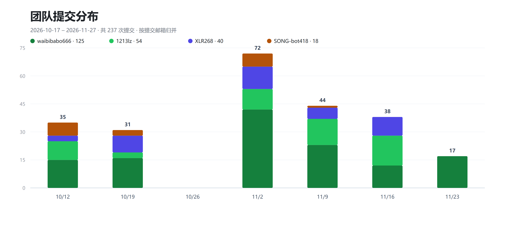
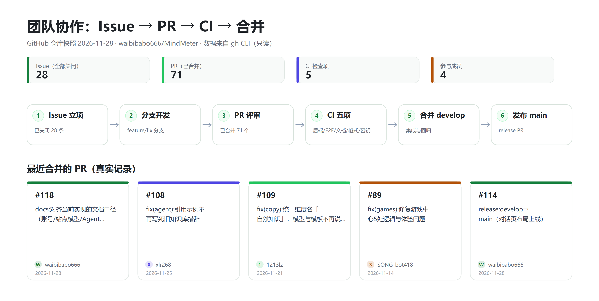
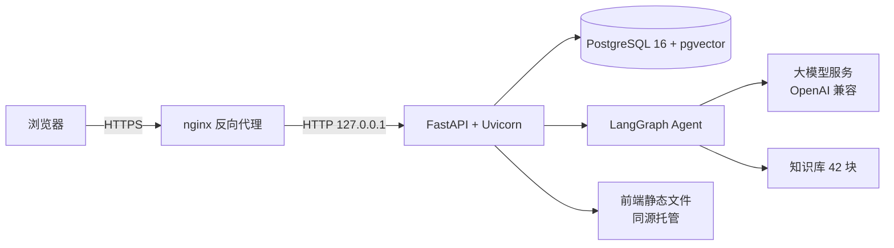
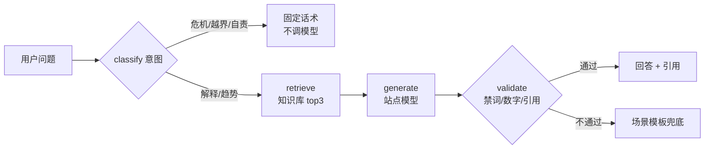
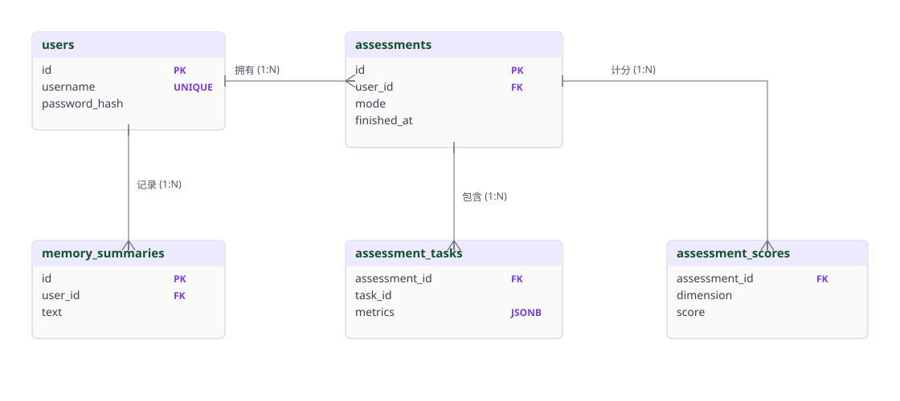
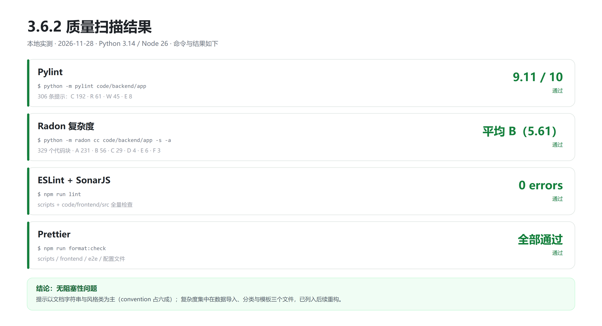
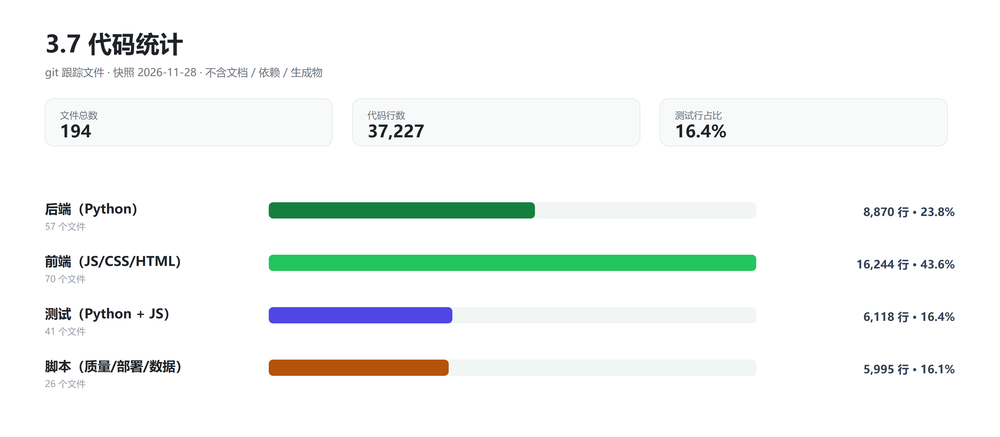

<!-- ============ 封面 ============ -->
<div class="cover">
  <p class="eyebrow">创新工程实践营 · 项目汇报</p>
  <h1>MindMeter 心智镜</h1>
  <p class="slogan">玩一局，看清你的大脑；聊一次，知道下一步。</p>
  <p class="meta">waibibabo666 ｜ xlr268 ｜ song ｜ 1213lz</p>
  <p class="date">2026 年 11 月</p>
</div>

<!-- [0:20] 一句话定位：8 项能力自测 + 对话式 Agent；不设总分、无常模、非诊断。 -->

---
layout: center
---

# 汇报结构

| 部分 | 时长 | 内容 |
| --- | --- | --- |
| 第一部分 | 8 分钟 | 产品设计 · 产品实现 · 软件质量 |
| 第二部分 | 2 分钟 | 本机运行，演示完整功能 |
| 第三部分 | 5 分钟 | 评委提问 |

<!-- [0:20] 说明节奏；本页对应参考文档的“第一部分 / 第二部分 / 第三部分”。 -->

---
layout: default
---

## 1.1.1 使命

让认知自测可解释、可回看的日常工具。

## 1.1.2 口号

**玩一局，看清你的大脑；聊一次，知道下一步。**

## 1.1.3 目标用户

18 岁以上、关注自身认知状态的学生与职场人；备考、长期用脑、想建立自我认知基线的人。

<!-- [0:40] 使命里的“不制造诊断权威”是后面所有设计的出发点。 -->

---
layout: default
---

## 1.1.4 如何获得用户

内容种草 + 校园演示：\
**小红书**（图文体验 / 科普，每周 2–3 篇）\
**B 站**（演示视频 / 开发日志，双周）\
**抖音**（15–60 秒切片，每周 3–4 条）

## 1.1.5 团队优势

- 4 人分工：项目负责人、产品与文案、后端与计分、前端与部署
- 协作机制：每周五演示、PR 评审、CI 五道门禁
- AI 协作 + 人工验收：代码与文档可追溯

<!-- [0:40] 获客讲真实渠道；团队优势落在分工与评审机制上。 -->

---
layout: default
---

## 1.1.6 如何做到差异化

| 对比对象 | 它们做什么 | 局限 | MindMeter |
| --- | --- | --- | --- |
| 临床量表（MoCA / MMSE） | 筛查、分界值、教育校正 | 面向临床、需专业人员施测 | 借鉴认知域框架，不采用其计分与分界值 |
| 娱乐型心理测评 | 趣味结果页、强分享 | 无依据、无复测 | 有计分规则、原始指标、可复测 |
| 通用 AI 聊天 | 自由对话 | 不能很好的参考测评数据 | 事实注入 + 数字白名单 + 引用 |
| 同类数字自测 | 红黄绿信号、引导就医 | 借临床权威、制造焦虑 | 自我基线比较，不做信号灯 |

<!-- [0:50] 重点讲第 1 行与第 4 行：既不做临床漏斗，也不做娱乐测评。 -->

---
layout: default
---

# 1.2 产品定义

**MindMeter 心智镜是一个面向普通人的 Web 认知自测与解读产品。**

- **能测**：8 项能力、三档 6 / 12 / 18 分钟，生成 0–100 参考分与原始指标报告；
- **能解释**：对话式 Agent 依据本次结果与知识库，解释「哪项低、为什么、怎么练」，并标注来源；
- **能记住**：保存画像、测评摘要与建议记录，下次不用从头说；
- **能回看**：复测只比共同维度，提示练习效应，不判断进步 / 退步；
- **能守住边界**：不设总分、没有常模、不做百分位、非诊断，只与自己的历史比较。

它不同于只给一个分数的脑力 App，也不同于一次性的临床量表——**我们做的是「测—评—建议—复测」的完整闭环**。

<!-- [0:40] 先讲产品整体能做什么，再讲边界；避免只介绍某一个特点。 -->

---
layout: default
---

# 1.2.1 解决的问题

| 问题 | 现状 | 我们的做法 |
| --- | --- | --- |
| 测完看不懂 | 只有一个分数，不知道意味着什么 | 报告 + 术语解释 + 怎么读这组数字 |
| 看完记不住 | 每次从零开始，建议反复 | 记忆：画像 / 摘要 / 建议记录 |
| 单次结论不可比 | 没有常模，却被拿去和别人比 | 自我基线：只与自己的复测比较 |

<!-- [0:40] 三个问题对应三个功能，不是堆功能。 -->

---
layout: default
---

# 1.2.2 对客户的价值

| 用户 | 完成了（活动） | 带来（价值） |
| --- | --- | --- |
| 习惯刷短视频、注意力被切碎的人 | 用 6 分钟快测完成一次八维自测 | 帮助检测认知水平 |
| 习惯把问题交给 AI 的人 | 追问「为什么这项低」「下一步怎么练」 | 得到有来源、可追溯的解释，而不是随口安慰或吓唬 |
| 关心自己脑力状态的人 | 隔两周复测，回看共同维度的变化 | 有依据地关心自己，而不是被「脑力下降」营销带着焦虑走 |

<!-- [0:40] 面向普通人而不是特定职业；价值落在「看清、可信、长期关心」。 -->

---
layout: default
---

# 1.2.3 解决方案：Web 应用

<div class="flow">
  <div class="step">注册 / 登录</div>
  <div class="arrow">→</div>
  <div class="step">选档位<br/><span>6 / 12 / 18 分钟</span></div>
  <div class="arrow">→</div>
  <div class="step">八维测评<br/><span>限时任务</span></div>
  <div class="arrow">→</div>
  <div class="step">八维报告<br/><span>无总分</span></div>
  <div class="arrow">→</div>
  <div class="step">对话解释<br/><span>引用 + 护栏</span></div>
  <div class="arrow">→</div>
  <div class="step">记忆 / 复测<br/><span>自我基线</span></div>
</div>

<!-- [0:40] 强调形态是 Web 应用，以及为什么不用小程序：同源托管、部署简单。 -->

---
layout: default
---

# 2 产品设计应用的原则

参考文档列出 12 条原则，这里挑与本品最相关的 6 条说明落地：

| 原则 | 在本产品中的落地 |
| --- | --- |
| 需求原则 | 先回答“分数能说明什么、不能说明什么”，再谈提升 |
| 信息原则 | 八维雷达 + 原始指标 + 来源，不加总分与排名噪音 |
| 创新原则 | 把一次性报告变成可追问、可回看的对话 |
| 系统原则 | 测评 → 计分 → 报告 → 对话 → 记忆 → 复测形成闭环 |
| 收敛原则 | 一个场景一条生成策略，不各写一套 |
| 简化原则 | 不做总分、百分位、账号等级、社交分享 |

<!-- [0:40] 每条原则都要落到具体设计，不能只念条文。 -->

---
layout: default
---

# 3.1 用户体验设计考虑的因素

| 因素 | 设计 |
| --- | --- |
| 设备 | 桌面与手机同一套页面；360px 宽度无横向滚动 |
| 等待 | 三阶段提示（检索 → 生成 → 兜底），不是只转圈 |
| 失败 | 用用户能懂的话说明降级原因 |
| 可访问性 | 跳转链接、对比度达标 |
| 隐私与边界 | 对话页常驻敏感信息提醒；报告页常驻非诊断声明 |

<!-- [0:40] 等待、失败、边界提示都是体验的一部分。 -->

---
layout: default
---

# 3.2 编程语言、框架与平台

| 条目 | 内容 |
| --- | --- |
| 程序设计语言 | Python 3.13 / JavaScript ES2022 |
| Web 框架 | FastAPI 0.162.7 + Uvicorn 0.54.0 |
| Agent 编排 | LangGraph 1.2.21 + langchain-core 1.8.0 |
| 数据层 | PostgreSQL 16 + pgvector 0.8.x；SQLAlchemy 2.1.8 / Alembic 1.20.1 |
| 前端 | 无框架，原生 ES Module（无构建） |
| 测试与质量 | pytest 9.2.0、Playwright 1.65、ESLint 10、Prettier 3.9 |

<p class="source">完整依赖见 requirements.txt / package.json；已同步到 README 的“技术栈与版本”一节。</p>

<!-- [0:40] 版本号以仓库锁定文件为准；选型理由下一页展开。 -->

---
layout: default
---

# 3.3 代码仓库链接及提交历史

- 仓库：**github.com/waibibabo666/MindMeter**
- 分支：`develop` 集成 → PR 评审 → `main` 发布
- 每次 PR 自动跑 CI：lint/format、浏览器 E2E、后端契约测试、文档结构、密钥扫描

| 成员 | 提交次数 | 主要职责 |
| --- | --- | --- |
| waibibabo666 | 125 | 项目负责人 |
| 1213lz | 54 | 计分 / RAG / 测试 |
| xlr268 | 40 | 产品与文案 |
| SONG-bot418 | 18 | 前端与部署 |


<!-- [0:40] 提交数据取自 git log 自动生成；本页为文字概览，下一页放完整图（pulse 截图位）。 -->

---
layout: default
---

# 3.3（续）提交历史图



<!-- [0:30] 图由 git log 自动生成：按周堆叠，四位成员的提交节奏一目了然。 -->

---
layout: default
---

## 3.3（续）团队协作工具

- **Issue**：需求、缺陷与待办都留档，按标签与里程碑归类
- **Pull Request**：每次改动走分支 + 评审，合并前必须过 CI
- **GitHub Projects**：L-01～L-09 任务看板，跟踪依赖与完成状态
- **CI**：lint/format、浏览器 E2E、后端契约测试、文档结构、密钥扫描

<!-- [0:40] 协作工具不是摆设：每个 Issue/PR 都能在仓库里查到。 -->

---
layout: default
---

# 3.3（续）协作流程



<!-- [0:30] 真实合并记录来自 gh CLI 只读拉取；六步流程对应仓库实际工作流。 -->

---
layout: default
---

# 3.4 生命周期：主要问题与解决

| 阶段 | 问题 | 原因 | 解决与沉淀 |
| --- | --- | --- | --- |
| 架构 | 桌面版数据不可迁移、Key 有风险 | localStorage + 浏览器直连模型 | 迁 FastAPI + PostgreSQL + 服务端会话；数据可跨设备、Key 不下发 |
| AI 出口 | 报告解读卡绕过校验 | 两条链路、两套 prompt | 报告与对话共用同一张图与同一套校验；AI 输出单一闸门 |
| 校验 | 缺引用或派生数字就整段回退 | 规则一刀切 | 场景策略 + 软/硬校验 + 数字派生白名单；好回答保留、坏回答兜底 |
| 趋势 | 只有表格，用户看不懂变化 | 缺趋势意图与数据组装 | TREND 意图 + 共享趋势组装 + 场景模板；趋势可追问 |
| 部署 | 服务器更新后仍是旧界面 | 前端打进镜像，只 pull 不重建 | 固化 pull → rebuild → 重启 + 上线冒烟；发布可复现 |

<!-- [0:50] 每条都对应 commit / ADR；答辩可展开任意一条。 -->

---
layout: default
---

# 3.4（续）测评依据：题库从哪来

| 维度 | 任务形式 | 依据 |
| --- | --- | --- |
| 语言（理解 / 流畅） | 词义辨析、限时说词 | 词汇语义判断 + 言语流畅性范式 |
| 数字运算 | 心算 | 系列减 7 / 心算负荷 |
| 知觉速度 | 符号匹配 | 数字符号替换（DSPT） |
| 归纳推理 | 规律归纳 | 类比与序列补全（Raven 血统） |
| 空间视觉 | 心理旋转 | Shepard & Metzler（1971） |
| 联想记忆 | 词对再认 | 词表延迟回忆 + 再认（信号检测） |

- 题目团队自编，不复制版权量表；知识库 42 块经 `reviewed` 门禁，回答标注来源
- 维度框架参考 MoCA 的认知域覆盖，但不采用其计分与分界值（ADR-0002）

<!-- [0:40] 题库来源讲清“范式出处 + 自编题目 + 知识库审核”。 -->

---
layout: default
---

# 3.4（续）科学性说明与局限

- **有的**：任务范式来自经典研究；计分规则公开可复算（`scoring-v3.3`）；AI 回答受数字白名单、引用与模板兜底约束；复测只比共同维度。
- **还没有**：没有大样本常模与信效度论文；**尚无用户实测数据**（目前只有团队与课程演示样本）；未做重测信度、内部一致性、聚合 / 区分效度分析。
- **因此**：单次分数受状态、设备与练习效应影响，只能作为**自我观察的参考**，不能用于诊断、能力定级或人群比较。

<!-- [0:50] 主动讲局限：没有常模、没有用户实测数据，这是答辩加分项。 -->

---
layout: default
---

# 3.5 软件概要设计：项目结构

```text
MindMeter/
├─ code/
│  ├─ backend/app/      api · agent · scoring · rag · models
│  ├─ backend/alembic/  数据库迁移
│  └─ frontend/src/     原生 ES Module：pages · tasks · charts · games
├─ docs/                 需求 · 算法 · 部署 · Agent 设计 · 幻灯片
├─ tests/                单元 / 集成 / 浏览器 E2E
└─ scripts/              质量门禁 · 部署 · 数据脚本
```

- 后端按职责分层：Agent、计分、检索各自独立目录，互不越界
- 前端无构建：页面与任务分离，FastAPI 直接托管
- 文档与代码同仓：PR 评审时一起看

<!-- [0:30] 目录结构说明“代码怎么组织”，对应 3.5 概要设计。 -->

---

# 3.5.1 系统架构图



- 基础设施：一台云服务器 + Docker 单容器；数据库同机或平台托管
- 安全：Cookie 会话（HttpOnly、SameSite=Lax）、同源 JSON 校验、限流、日志脱敏

<!-- [0:50] 架构图按“浏览器 → 反代 → 应用 → 数据/模型/知识”讲，从外到内。 -->

---
layout: default
---

## 3.5.2 基础设施图

只有一台云服务器：Docker 单容器 + 同机或平台 PostgreSQL，nginx 负责 TLS 与反向代理

## 3.5.3 智能体设计（上）



- 任务编排：LangGraph 显式状态机，场景策略表（对话 / 趋势 / 报告）
- 知识：42 块已审核语料，检索命中不足时明说“不猜”
- 记忆：画像、测评摘要、建议记录、最近 20 条对话

<!-- [1:00] 五要素先讲编排、知识、记忆；护栏与降级下一页。 -->

---
layout: default
---

## 3.5.3（续）护栏与降级

| 层 | 规则 |
| --- | --- |
| 意图 | 危机、越界、自责、无关：不调模型，走固定话术（含 12356 求助通道） |
| 场景 | 对话 200 字 / 趋势 300 字 / 报告 150 字；趋势禁用“进步 / 退步”判断 |
| 数字 | 只允许 facts 里的数字及确定性派生（百分比、差值、秒数） |
| 兜底 | 任一硬校验失败 → 场景模板；软校验只记录、不判死 |

<!-- [0:50] 这一页是答辩重点：说明 AI 不会碰分数与结论。 -->

---
layout: default
---

# 3.5.4 数据库设计



- 15 张表按五组管理：账号 / 测评 / 记忆 / 知识与 AI / 游戏
- 其余表：chat_messages、memory_advice、kb_chunks、ai_runs、game_*、audit_log
- 删除账号级联清理；`kb_chunks.review_status` 未审核不进检索

<!-- [0:40] ER 图展示主外键关系；其余表（游戏、审计）在文档中列出。 -->

---
layout: default
---

# 3.5.5 接口设计（节选）

| 接口 | 功能 | 输入 | 输出 |
| --- | --- | --- | --- |
| `POST /auth/register` | 注册 | 用户名、密码、成年确认 | 会话 Cookie |
| `POST /auth/login` | 登录 | 用户名、密码 | 会话 Cookie |
| `POST /assessments` | 提交测评并计分 | 作答与指标 | 八维分数 + 原始指标 |
| `POST /reports/{id}/explain` | 解读报告 | 测评 ID | 解读文本 + 来源 |
| `POST /chat` | 对话 | 问题 | 回答 + 引用 + 意图 |
| `GET /trends` | 趋势对比 | — | 共同维度差值、间隔 |

<!-- [0:40] 只列核心业务接口；工具类接口与游戏接口在 OpenAPI 文档里。 -->

---
layout: default
---

# 3.5.6 前端设计

- **无构建**：原生 ES Modules + hash 路由，FastAPI 直接托管，部署零额外步骤
- **设计系统**：CSS 变量统一颜色 / 间距 / 字号；内联 SVG 图标，不引第三方 UI 库
- **响应式**：容器查询按主区宽度分栏；360px 无横向滚动（E2E 断言）
- **可访问性**：跳转链接、`aria-live` 状态、键盘焦点环、对比度达标

<!-- [0:30] 前端不引框架是刻意选择：小团队、部署简单、可控。 -->

---
layout: default
---

# 3.6.1 质量控制和保证方法

| 层 | 做法 |
| --- | --- |
| 日志 | 关键路径记录、日志脱敏，不写 Key 与完整对话 |
| 异常 | 错误码收敛；模型失败、校验失败都有确定性兜底 |
| 测试 | pytest 430 passed（CI）；前端 12 套纯逻辑；Playwright E2E 15 条覆盖主链路 |
| CI | 五道门禁：lint/format、E2E、后端契约、文档结构、密钥扫描 |

<!-- [0:40] 质量不靠人工自觉，靠 CI 门禁；测试数量取自最近一次全量运行。 -->

---
layout: default
---

# 3.6.2 质量工具使用

| 工具 | 用途 | 状态 |
| --- | --- | --- |
| ESLint + SonarJS | JS 规范与复杂度门禁 | CI 与本地均通过 |
| Prettier | 格式统一 | CI 检查通过 |
| pytest / Playwright | 单测、集成、E2E | 全绿 |
| Pylint / 复杂度扫描 | Python 语义与复杂度 | 9.11/10 · 平均 B（5.61） |

<!-- [0:40] Java 的 p3c 不适用本项目；Python 侧用 Pylint 与 Radon 复杂度扫描。 -->

---
layout: default
---

# 3.6.2（续）质量扫描结果



<!-- [0:30] 本地实测：Pylint 9.11/10，Radon 329 个代码块平均 B（5.61），ESLint/Prettier 通过。 -->

---
layout: default
---

## 3.7.1 模块数 / 3.7.2 行数

| 范围 | 文件数 | 行数 |
| --- | --- | --- |
| 后端（Python） | 57 | 8,870 |
| 前端（JS/CSS/HTML） | 70 | 16,244 |
| 测试（Python + JS） | 41 | 6,118 |
| 脚本（质量 / 部署 / 数据） | 26 | 5,995 |
| **合计** | **194** | **37,227** |

<p class="source">AI 协作：需求梳理、代码、测试与文档大量由 AI 起草，人工负责范围界定、评审与验收；比例不做精确统计以免误导。</p>

<!-- [0:40] 模块数与行数为当前仓库实测；AI 比例如实说明，不虚报。 -->

---
layout: default
---

# 3.7（续）代码统计图



<!-- [0:30] 统计口径：git 跟踪文件；测试行占 16.4%，前端占 43.6%。 -->

---
layout: center
---

# 第二部分：功能展示

<!-- [2:00] 现场演示；网络异常时自动走模板，流程不中断。 -->

---
layout: center
---

# 第三部分：答辩

---
layout: center
---

# 谢谢

<p class="slogan">玩一局，看清你的大脑；聊一次，知道下一步。</p>

| 入口 | 地址 |
| --- | --- |
| 仓库 | github.com/waibibabo666/MindMeter |

<p class="source">对应《创新工程实践营》考核：产品设计 8 分钟 + 功能演示 2 分钟 + 答辩 5 分钟。</p>
